<p align="center"></p>

# Kalendar

🇫🇷 [Français](README.md) · 🇬🇧 [English](README.en.md) · 🇩🇪 **Deutsch**

Eine **inoffizielle** Android-Kalender-App für ein [Infomaniak](https://www.infomaniak.com)-Konto, mit zwei Widgets (Agenda und Monat). Sie liest und schreibt deine Kalender direkt über CalDAV: Der Synchronisations-Assistent und die Infomaniak-Apps sind nicht nötig.

**[⬇ Neueste Version herunterladen](https://github.com/nthnbch/kalendar/releases/latest)** (`.apk`-Datei, ab Android 8.0) · [In 3 Minuten installieren](#kalendar-installieren)

> Privates Projekt, nicht mit Infomaniak verbunden. Die Nutzung erfolgt auf eigene Verantwortung: Sichere deinen Kalender, bevor du die App mit wichtigen Daten ausprobierst.

## Screenshots

Heller und dunkler Modus (in den Einstellungen wählbar oder vom System übernommen), hier auf Französisch; die App gibt es auch auf Englisch, Deutsch und Spanisch.

<table>
  <tr>
    <td align="center">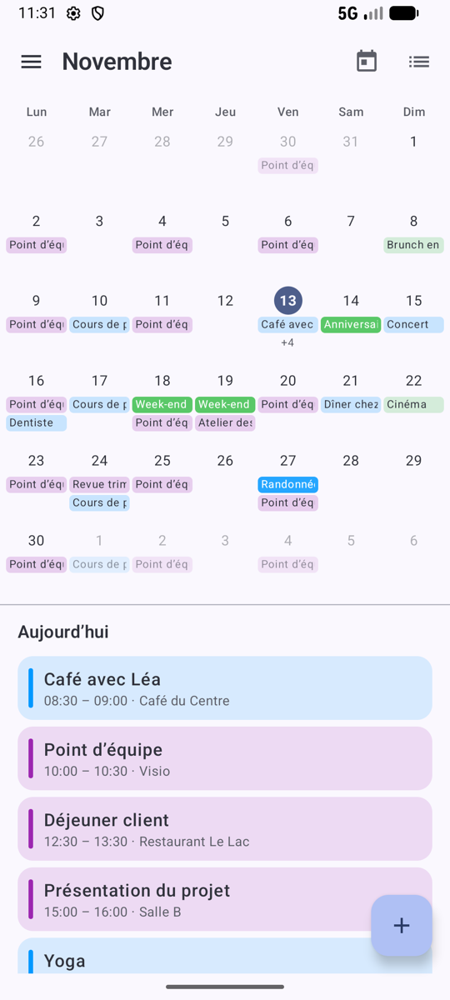<br><sub>Monat</sub></td>
    <td align="center">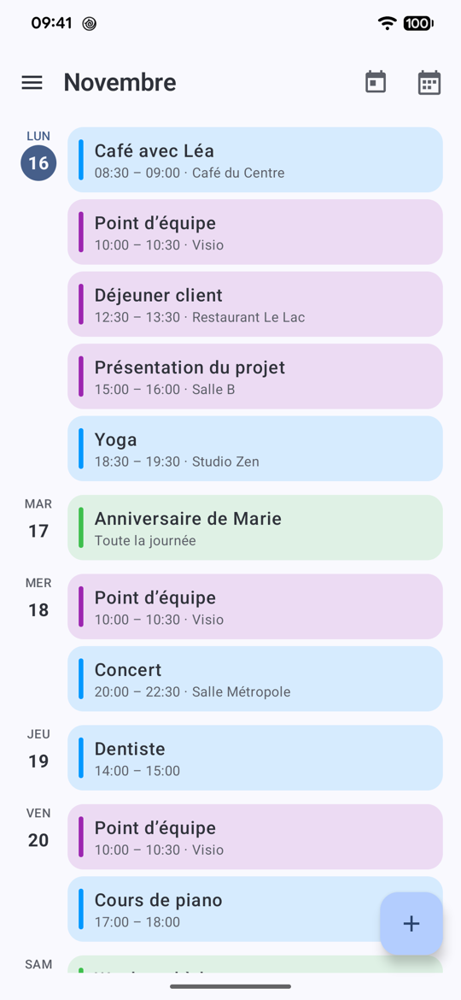<br><sub>Agenda</sub></td>
    <td align="center">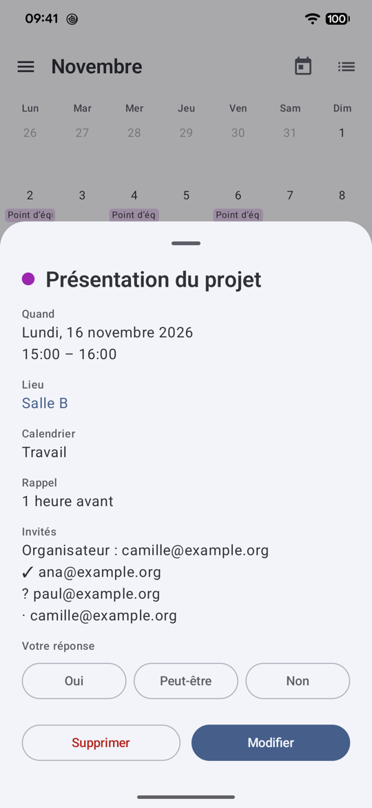<br><sub>Details und Gäste</sub></td>
  </tr>
  <tr>
    <td align="center">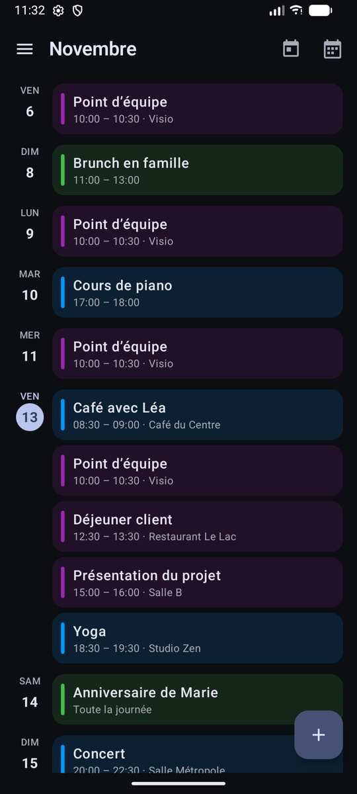<br><sub>Agenda, dunkles Design</sub></td>
    <td align="center">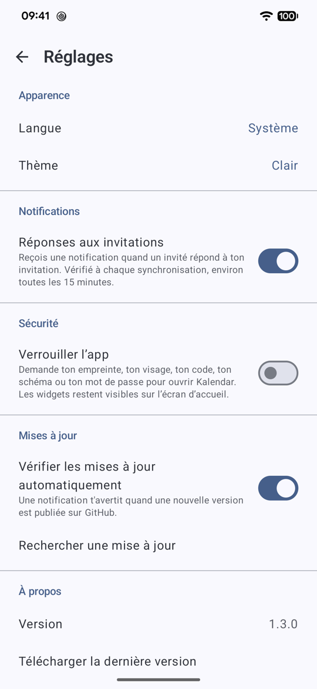<br><sub>Einstellungen</sub></td>
    <td align="center">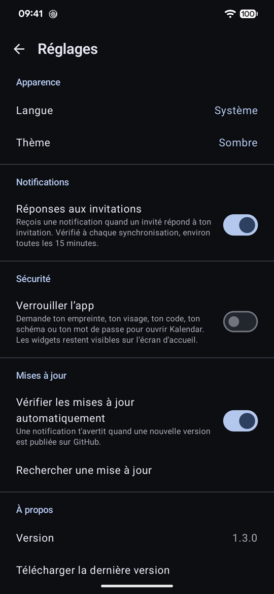<br><sub>Einstellungen, dunkles Design</sub></td>
  </tr>
</table>

### Wischgesten bei einem Termin

In der Liste eines Tages wie in der Agenda-Ansicht: Wische einen Termin **nach rechts, um ihn zu bearbeiten**, **nach links, um ihn zu löschen**. Die Geste fragt nur nach: Der Bearbeitungsbildschirm öffnet sich oder die Löschbestätigung erscheint (bei einer Serie mit der Wahl «dieses Vorkommen / dieses und die folgenden / ganze Serie»). Schreibgeschützte Kalender haben diese Gesten nicht.

<table>
  <tr>
    <td align="center">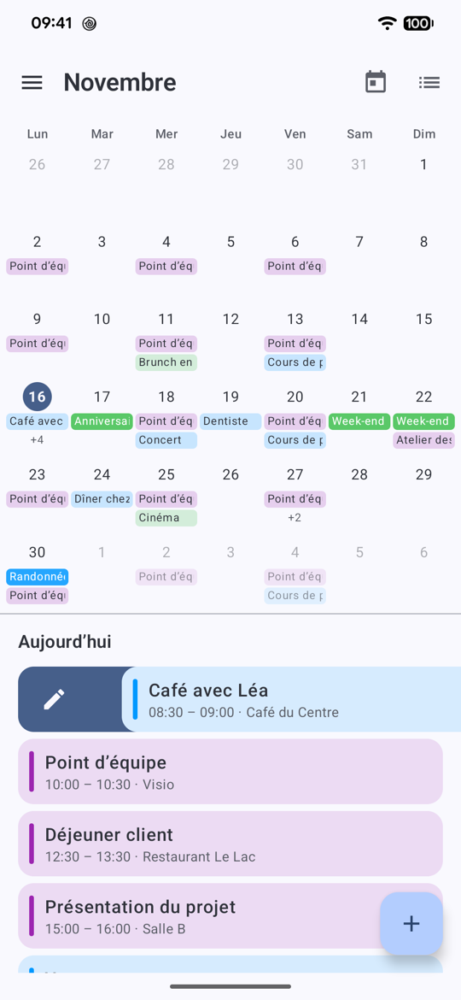<br><sub>Rechts: bearbeiten</sub></td>
    <td align="center">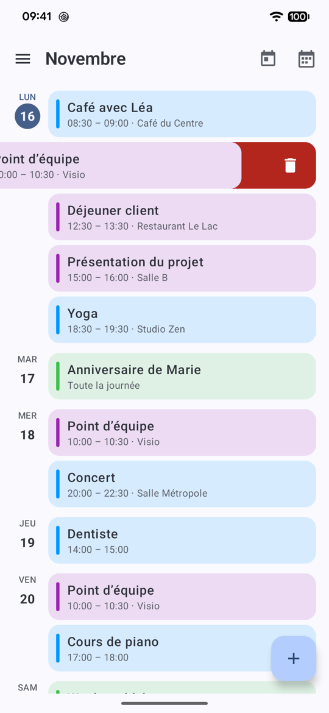<br><sub>Links: löschen</sub></td>
  </tr>
</table>

### Widgets

<table>
  <tr>
    <td align="center">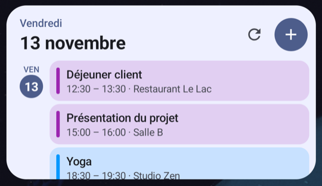<br><sub>Agenda, hell</sub></td>
    <td align="center">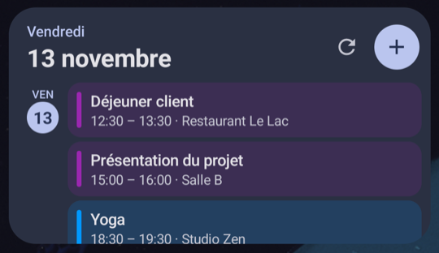<br><sub>Agenda, dunkel</sub></td>
  </tr>
  <tr>
    <td align="center">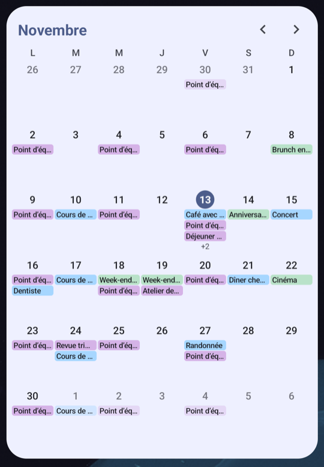<br><sub>Monat, hell</sub></td>
    <td align="center">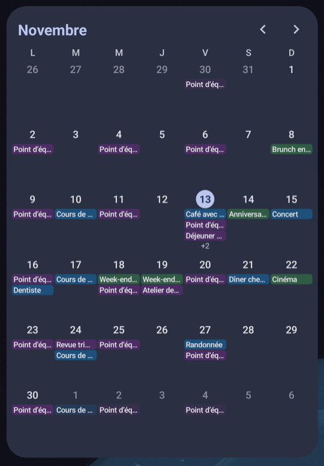<br><sub>Monat, dunkel</sub></td>
  </tr>
</table>

Die Widgets folgen dem System-Design. Die Daten in den Screenshots sind erfunden (siehe «Screenshots (Demo-Build)» weiter unten).

## Funktionen

- **Ansichten**: Monat und Agenda, mehrere Kalender mit ihren Farben, jeden Kalender ein- oder ausblendbar.
- **Gesten**: Termin nach rechts wischen zum Bearbeiten, nach links zum Löschen.
- **Termine**: erstellen, bearbeiten, löschen; ganztägig, Zeitzonen, Ort, Notizen, Erinnerungen.
- **Serientermine**: *dieses Vorkommen*, *dieses und die folgenden* oder *die ganze Serie* bearbeiten oder löschen.
- **Einladungen**: Organisator und Antworten der Gäste sehen, antworten (Ja / Vielleicht / Nein), Personen per E-Mail einladen (bereits verwendete Adressen werden beim nächsten Mal vorgeschlagen). Der Server verschickt die Einladungs- und Antwort-Mails.
- **Erinnerungen**: pünktliche Benachrichtigungen, auch wenn das Gerät schläft. Standardmässig eine Erinnerung 1 Stunde vorher; ein neuer Termin dauert 1 Stunde und beginnt um 06:00 (heute zur nächsten vollen Stunde).
- **Antworten auf Einladungen**: eine Benachrichtigung, wenn ein Gast auf eine von dir gesendete Einladung antwortet (Ja, Vielleicht, Nein). CalDAV kennt kein Push: Die Antwort wird bei der nächsten Synchronisation erkannt, spätestens nach etwa 15 Minuten.
- **Sprachen**: Französisch, Englisch, Deutsch, Spanisch. Standardmässig die Systemsprache, oder eine Wahl in den Einstellungen.
- **Design**: hell, dunkel oder das des Systems.
- **App-Sperre**: Die App kann nach Fingerabdruck, Gesicht, PIN, Muster oder Bildschirmpasswort fragen. Die Widgets bleiben auf dem Startbildschirm sichtbar.
- **Widgets**: *Agenda* (die nächsten Termine, Tag für Tag) und *Monat* (Monatsraster mit den Terminnamen in jedem Feld, Navigation von Monat zu Monat; ein Tipp auf den Monatsnamen springt zum aktuellen Monat).
- **Updates**: Die App prüft auf GitHub, ob es eine neue Version gibt, meldet dies per Benachrichtigung (abschaltbar) und lädt sie zur Installation herunter, unter *Einstellungen → Updates*. Android verlangt vor jeder Installation eine Bestätigung: Ein völlig stilles Update ist nicht möglich.
- **Offline**: Bereits synchronisierte Termine bleiben sichtbar; ohne Netz weist die App darauf hin und ändert nichts.
- **Synchronisation**: alle 15 Minuten, beim Öffnen und auf Wunsch. Änderungen werden abgelehnt, wenn sich der Termin inzwischen auf dem Server geändert hat (kein stilles Überschreiben).
- **Datenschutz**: Das Passwort wird mit dem Android-Keystore verschlüsselt; die App spricht nur mit deinem CalDAV-Server.

## Kalendar installieren

Es muss nichts kompiliert werden: Die App wird fertig veröffentlicht.

### 1. App herunterladen

1. Öffne auf deinem Android-Telefon die Seite der [**Releases**](https://github.com/nthnbch/kalendar/releases/latest).
2. Lade die Datei **`Kalendar-x.y.z.apk`** der neuesten Version herunter.
3. Öffne sie. Android fragt, ob du die Installation von Apps aus diesem Browser (oder Dateimanager) erlauben willst: Bestätige und tippe auf *Installieren*. Ab Android 8.0.

Spätere Versionen werden über die bestehende installiert, deine Einstellungen bleiben erhalten. Nach der Installation meldet die App selbst, wenn eine neue Version erscheint, und kann sie herunterladen (*Einstellungen → Updates*).

### 2. Ein Infomaniak-App-Passwort

Die App meldet sich mit einer Synchronisations-ID und einem App-Passwort an (nicht mit deinem Konto-Passwort):

1. Gehe auf <https://config.infomaniak.com> und öffne den Synchronisations-Assistenten.
2. Wähle die Kalender-Synchronisation und erzeuge ein App-Passwort.
3. Notiere die angezeigte **ID** (der Form `AB12345`) und das **Passwort**.

### 3. Anmelden

In der App: Server `https://sync.infomaniak.com`, ID und App-Passwort aus Schritt 2. Die Kalender erscheinen nach der ersten Synchronisation.

### 4. Widgets hinzufügen

Startbildschirm lange drücken → *Widgets* → *Kalendar* → *Agenda* oder *Monat*.

### 5. Einstellungen

Menü ☰ → *Einstellungen*: Sprache, Design, Benachrichtigungen bei Antworten auf Einladungen, App-Sperre, Updates, Version und Link zum Quellcode ([github.com/nthnbch/kalendar](https://github.com/nthnbch/kalendar)).

## Für Entwickler: selbst kompilieren

Voraussetzungen: **JDK 17** und das **Android SDK** (Variable `ANDROID_HOME` oder `sdk.dir` in `local.properties`).

```bash
git clone https://github.com/nthnbch/kalendar.git
cd kalendar
./gradlew assembleDebug
adb install -r app/build/outputs/apk/debug/app-debug.apk
```

Oder öffne den Ordner in Android Studio und starte die App auf einem Telefon.

### Signierte Version

Für einen signierten «Release»-Build erstelle im Hauptverzeichnis eine Datei `keystore.properties` (sie wird von git ignoriert):

```properties
storeFile=kalendar-release.jks
storePassword=...
keyAlias=...
keyPassword=...
```

dann `./gradlew assembleRelease`. **Sichere deinen Schlüssel**: Ohne ihn lässt sich kein Update veröffentlichen, das über die vorherige Version installiert werden kann.

## Anmeldung mit dem Infomaniak-Button (deaktiviert)

Der Code enthält eine OAuth-Anmeldung, die standardmässig ausgeblendet ist: Infomaniak vergibt die nötigen Rechte (`user_info`, `user_password`) nur an eigene Apps. Falls sich das ändert, füge in `local.properties` hinzu: `infomaniakClientId=...`, `infomaniakClientSecret=...` und `infomaniakOAuth=true`.

## Tests

```bash
./gradlew testDebugUnitTest
```

Die Tests decken ab: Lesen und Schreiben von iCalendar, Wiederholungen, vollständiges CRUD eines Termins (erstellen, lesen, ändern, löschen), Bearbeiten eines Vorkommens oder einer Serie (*dieses Vorkommen*, *die folgenden*), Einladungen und Antworten (inklusive Erkennung einer Gast-Antwort) und den CalDAV-Client gegen einen simulierten Server (ETag, Konflikte, Authentifizierung).
Die Android-Schicht (Bildschirme, Widgets, Benachrichtigungen, Netzwerkprüfung) hat keine automatischen Tests; sie wurde von Hand auf einem Emulator und einem Gerät geprüft.

## Screenshots (Demo-Build)

Die Screenshots stammen aus einem `demo`-Build: andere Anwendungs-ID (`ch.nthnbch.kalendar.demo`), installierbar neben der echten App, mit erfundenem Konto und Kalender.

```bash
./gradlew assembleDemo
adb install -r app/build/outputs/apk/demo/app-demo.apk
adb shell am broadcast -n ch.nthnbch.kalendar.demo/ch.nthnbch.kalendar.demo.SeedReceiver
adb shell am force-stop ch.nthnbch.kalendar.demo   # dann die App öffnen
```

## Struktur

```
app/src/main/java/ch/nthnbch/kalendar/
  dav/      CalDAV-Client (OkHttp)
  ical/     iCalendar lesen / schreiben, Wiederholungen
  data/     lokale Datenbank, Synchronisation, Alarme, verschlüsseltes Konto
  ui/       Bildschirme (Jetpack Compose): Agenda, Editor, Einstellungen, Sperre
  widget/   Glance-Widgets (Agenda, Monat)
```
