<p align="center"></p>

# Kalendar

🇫🇷 [Français](README.md) · 🇬🇧 **English** · 🇩🇪 [Deutsch](README.de.md)

An **unofficial** Android calendar app for an [Infomaniak](https://www.infomaniak.com) account, with two widgets (agenda and month). It reads and writes your calendars directly over CalDAV: no need for the sync assistant or the Infomaniak apps.

**[⬇ Download the latest version](https://github.com/nthnbch/kalendar/releases/latest)** (`.apk` file, Android 8.0 or later) · [Install in 3 minutes](#install-kalendar)

> Personal project, not affiliated with Infomaniak. Use at your own risk: back up your calendar before trying it on important data.

## Screenshots

Light and dark themes (chosen in the settings, or following the system), shown here in French; the app is also available in English, German and Spanish.

<table>
  <tr>
    <td align="center">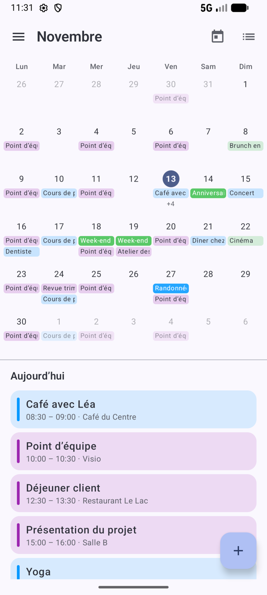<br><sub>Month</sub></td>
    <td align="center">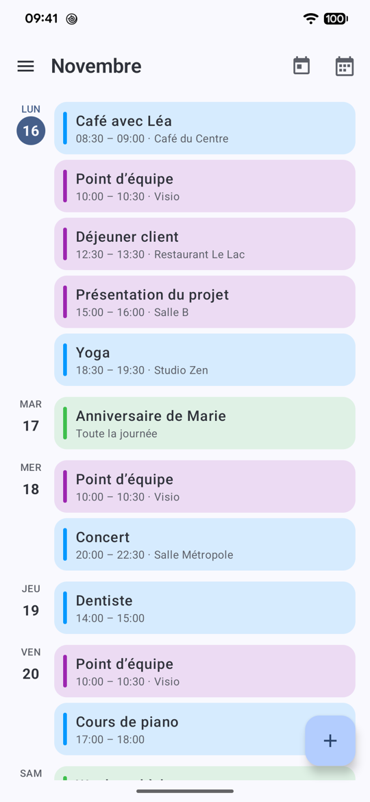<br><sub>Agenda</sub></td>
    <td align="center">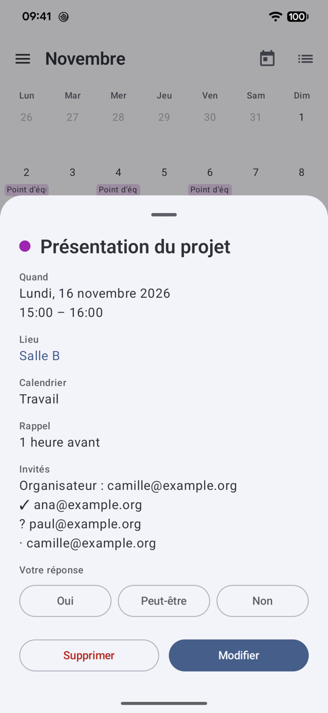<br><sub>Details and guests</sub></td>
  </tr>
  <tr>
    <td align="center">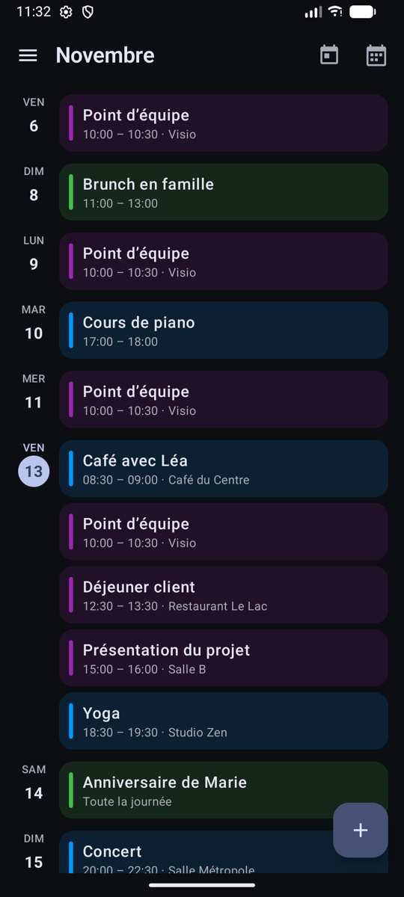<br><sub>Agenda, dark theme</sub></td>
    <td align="center">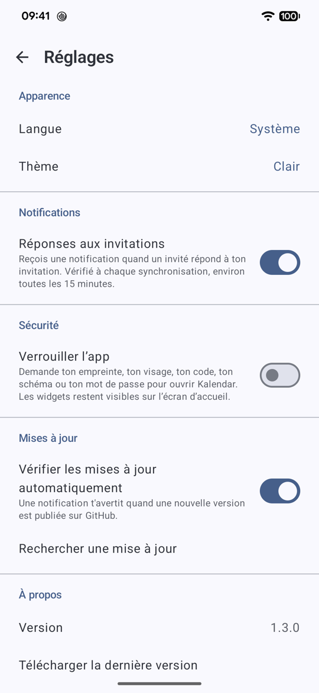<br><sub>Settings</sub></td>
    <td align="center">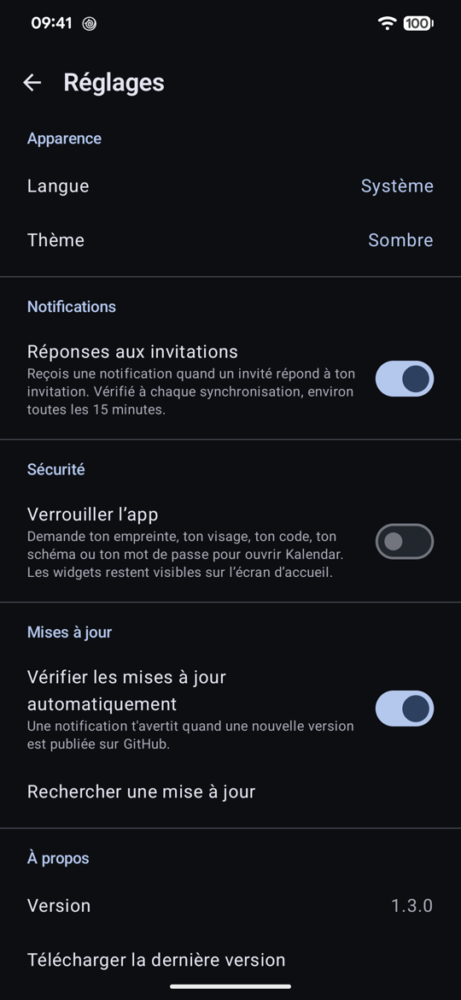<br><sub>Settings, dark theme</sub></td>
  </tr>
</table>

### Swipe gestures on an event

In a day's list, as in the agenda view: swipe an event **right to edit it**, **left to delete it**. A swipe only asks: the edit screen opens, or the delete confirmation appears (with the choice "this occurrence / this and following / the whole series" for a series). Read-only calendars have no swipe gestures.

<table>
  <tr>
    <td align="center">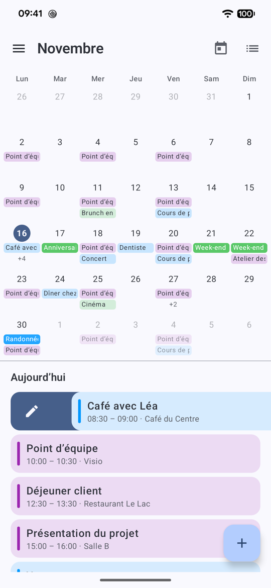<br><sub>Right: edit</sub></td>
    <td align="center">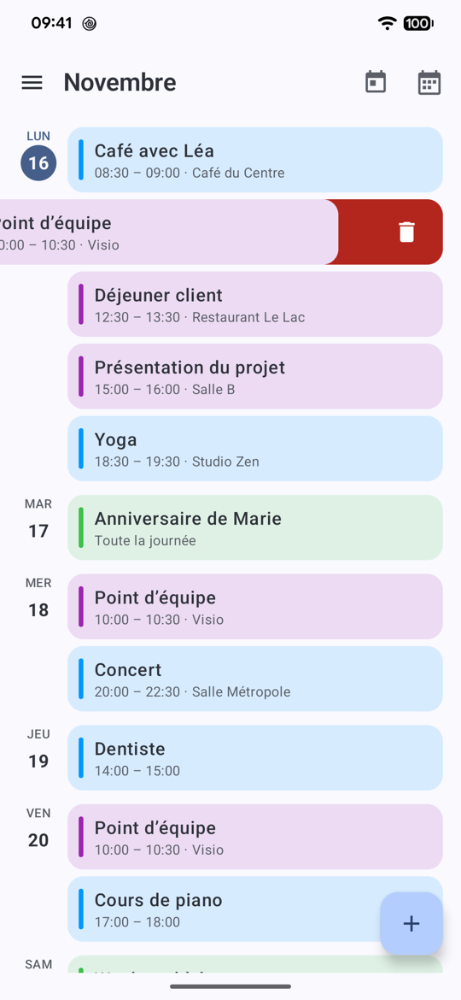<br><sub>Left: delete</sub></td>
  </tr>
</table>

### Widgets

<table>
  <tr>
    <td align="center">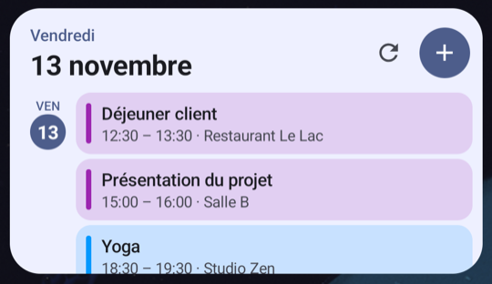<br><sub>Agenda, light</sub></td>
    <td align="center">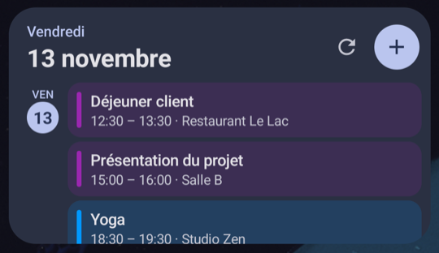<br><sub>Agenda, dark</sub></td>
  </tr>
  <tr>
    <td align="center">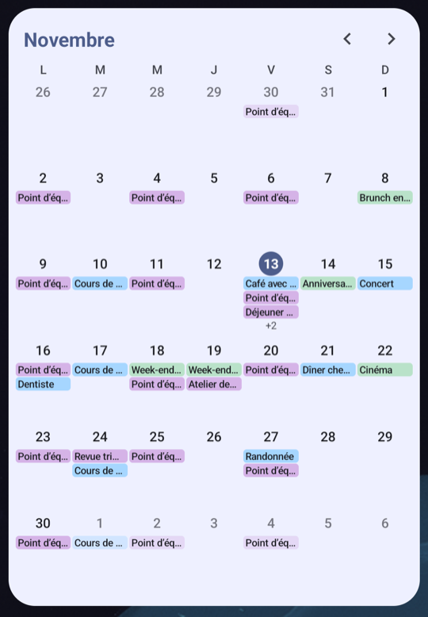<br><sub>Month, light</sub></td>
    <td align="center">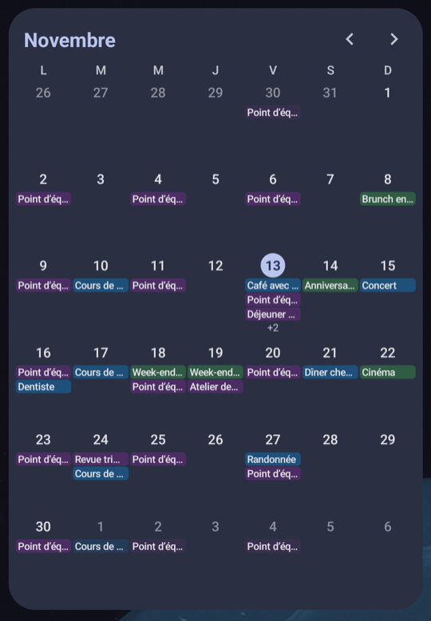<br><sub>Month, dark</sub></td>
  </tr>
</table>

The widgets follow the system theme. The data in the screenshots is fictional (see "Screenshots (demo build)" below).

## Features

- **Views**: month and agenda, several calendars with their colors, show or hide each calendar.
- **Gestures**: swipe an event right to edit it, left to delete it.
- **Events**: create, edit, delete; all-day events, time zones, location, notes, reminders.
- **Recurring series**: edit or delete *this occurrence*, *this and following*, or *the whole series*.
- **Invitations**: see the organizer and the guests' answers, reply (yes / maybe / no), invite people by e-mail (addresses you already used are suggested next time). The server sends the invitation and reply e-mails.
- **Reminders**: notifications on time, even when the device is asleep. By default a reminder 1 hour before; a new event lasts 1 hour and starts at 06:00 (or at the next full hour, today).
- **Replies to invitations**: a notification when a guest answers (yes, maybe, no) an invitation you sent. CalDAV has no push: the answer is spotted at the next synchronisation, about 15 minutes later at most.
- **Languages**: French, English, German, Spanish. The system language by default, or a choice in the settings.
- **Theme**: light, dark, or the system's.
- **App lock**: the app can ask for your fingerprint, face, PIN, pattern or screen password. The widgets stay visible on the home screen.
- **Widgets**: *Agenda* (upcoming events, day by day) and *Month* (month grid with event names in each cell, month-to-month navigation; tapping the month name returns to the current month).
- **Updates**: the app checks GitHub for a newer version, tells you with a notification (can be turned off) and downloads it to install, from *Settings → Updates*. Android always asks for a confirmation before installing: a fully silent update is not possible.
- **Offline**: events already synchronised stay visible; without a network, the app says so and changes nothing.
- **Synchronisation**: every 15 minutes, on opening, and on demand. Changes are refused if the event changed on the server in the meantime (no silent overwriting).
- **Privacy**: the password is encrypted with the Android Keystore; the app only talks to your CalDAV server.

## Install Kalendar

No need to build anything: the app is published ready to install.

### 1. Download the app

1. On your Android phone, open the [**releases**](https://github.com/nthnbch/kalendar/releases/latest) page.
2. Download the **`Kalendar-x.y.z.apk`** file of the latest version.
3. Open it. Android asks you to allow installing apps from this browser (or file manager): accept, then tap *Install*. Android 8.0 or later.

Later versions install over the existing one, keeping your settings. Once installed, the app tells you itself when a new version is out and can download it (*Settings → Updates*).

### 2. An Infomaniak app password

The app signs in with a sync ID and an app password (not your account password):

1. Go to <https://config.infomaniak.com> and open the sync assistant.
2. Choose the calendar sync and generate an app password.
3. Note the **ID** (like `AB12345`) and the **password** shown.

### 3. Sign in

In the app: server `https://sync.infomaniak.com`, the ID and app password from step 2. Your calendars appear after the first synchronisation.

### 4. Add the widgets

Long-press the home screen → *Widgets* → *Kalendar* → *Agenda* or *Month*.

### 5. Settings

Menu ☰ → *Settings*: language, theme, notifications for replies to invitations, app lock, updates, version and a link to the source code ([github.com/nthnbch/kalendar](https://github.com/nthnbch/kalendar)).

## For developers: build it yourself

Requirements: **JDK 17** and the **Android SDK** (`ANDROID_HOME` variable, or `sdk.dir` in `local.properties`).

```bash
git clone https://github.com/nthnbch/kalendar.git
cd kalendar
./gradlew assembleDebug
adb install -r app/build/outputs/apk/debug/app-debug.apk
```

Or open the folder in Android Studio and run the app on a phone.

### Signed build

For a signed "release" build, create a `keystore.properties` file at the root (it is ignored by git):

```properties
storeFile=kalendar-release.jks
storePassword=...
keyAlias=...
keyPassword=...
```

then `./gradlew assembleRelease`. **Back up your key**: without it, you cannot publish an update that installs over the previous version.

## Sign-in with the Infomaniak button (disabled)

The code contains an OAuth sign-in, hidden by default: Infomaniak only grants the required scopes (`user_info`, `user_password`) to its own apps. If that changes, add to `local.properties`: `infomaniakClientId=...`, `infomaniakClientSecret=...` and `infomaniakOAuth=true`.

## Tests

```bash
./gradlew testDebugUnitTest
```

The tests cover iCalendar parsing and writing, recurrences, full event CRUD (create, read, update, delete), editing an occurrence or a series (*this occurrence*, *following*), invitations and replies (including detecting a guest's reply), and the CalDAV client against a mock server (ETag, conflicts, authentication).
The Android layer (screens, widgets, notifications, network check) has no automated tests; it was checked by hand on an emulator and on a device.

## Screenshots (demo build)

The screenshots come from a `demo` build: a different application ID (`ch.nthnbch.kalendar.demo`), installable next to the real app, with an invented account and calendar.

```bash
./gradlew assembleDemo
adb install -r app/build/outputs/apk/demo/app-demo.apk
adb shell am broadcast -n ch.nthnbch.kalendar.demo/ch.nthnbch.kalendar.demo.SeedReceiver
adb shell am force-stop ch.nthnbch.kalendar.demo   # then open the app
```

## Structure

```
app/src/main/java/ch/nthnbch/kalendar/
  dav/      CalDAV client (OkHttp)
  ical/     iCalendar parsing / writing, recurrences
  data/     local database, synchronisation, alarms, encrypted account
  ui/       screens (Jetpack Compose): agenda, editor, settings, lock
  widget/   Glance widgets (agenda, month)
```
