<p align="center"></p>

# Kalendar

🇫🇷 **Français** · 🇬🇧 [English](README.en.md) · 🇩🇪 [Deutsch](README.de.md)

Une application de calendrier Android **non officielle** pour un compte [Infomaniak](https://www.infomaniak.com), avec deux widgets (agenda et mois). Elle lit et écrit tes calendriers directement par CalDAV : pas besoin de l'assistant de synchronisation ni des applications Infomaniak.

**[⬇ Télécharger la dernière version](https://github.com/nthnbch/kalendar/releases/latest)** (fichier `.apk`, Android 8.0 minimum) · [Installation en 3 minutes](#installer-kalendar)

> Projet personnel, sans lien avec Infomaniak. Le code est sous ta responsabilité : fais une sauvegarde de ton agenda avant de l'essayer sur des données importantes.

## Captures d'écran

Thème clair et sombre (au choix dans les réglages, ou celui du système), ici en français ; l'app existe aussi en anglais, allemand et espagnol.

<table>
  <tr>
    <td align="center">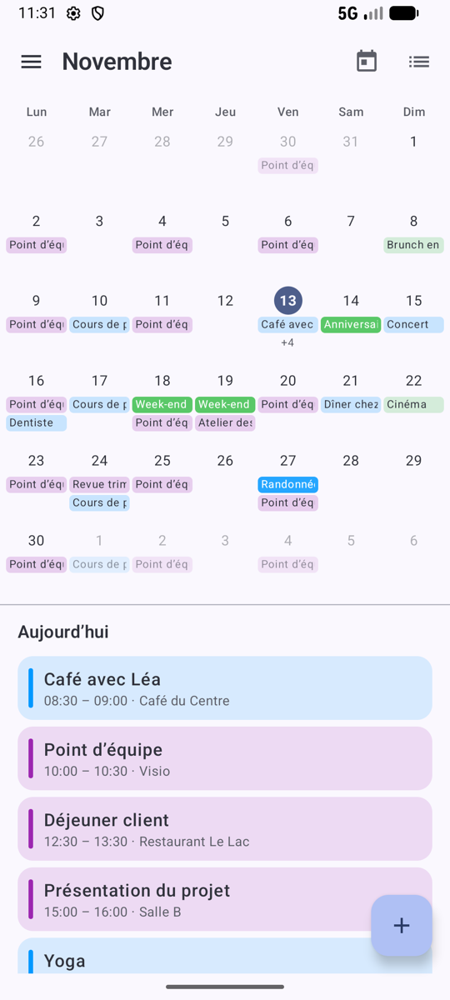<br><sub>Mois</sub></td>
    <td align="center">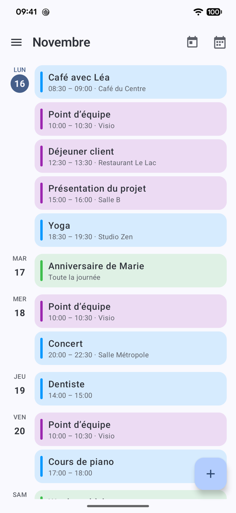<br><sub>Agenda</sub></td>
    <td align="center">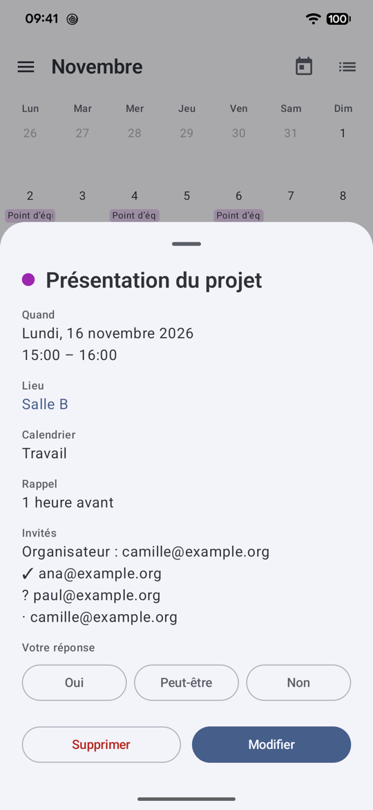<br><sub>Détail et invités</sub></td>
  </tr>
  <tr>
    <td align="center">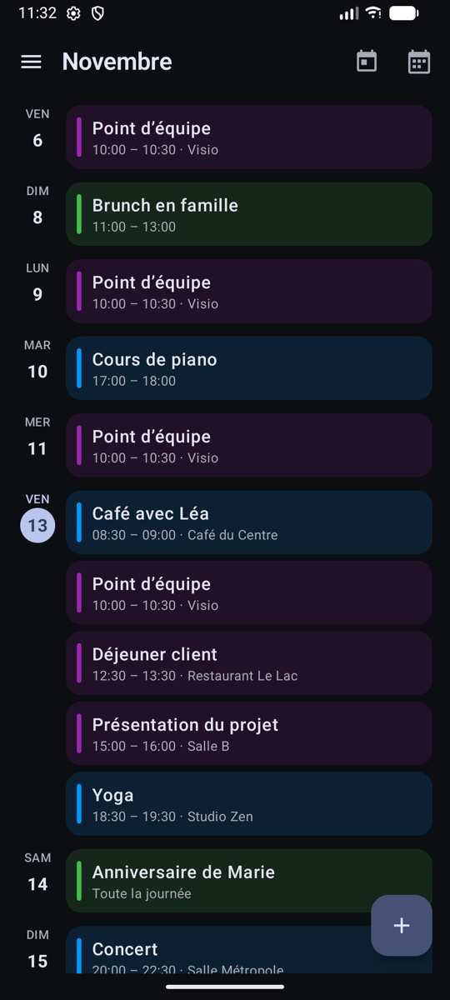<br><sub>Agenda, thème sombre</sub></td>
    <td align="center">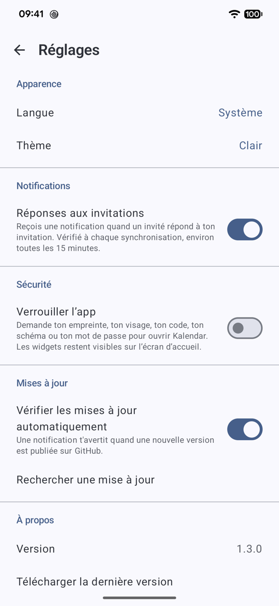<br><sub>Réglages</sub></td>
    <td align="center">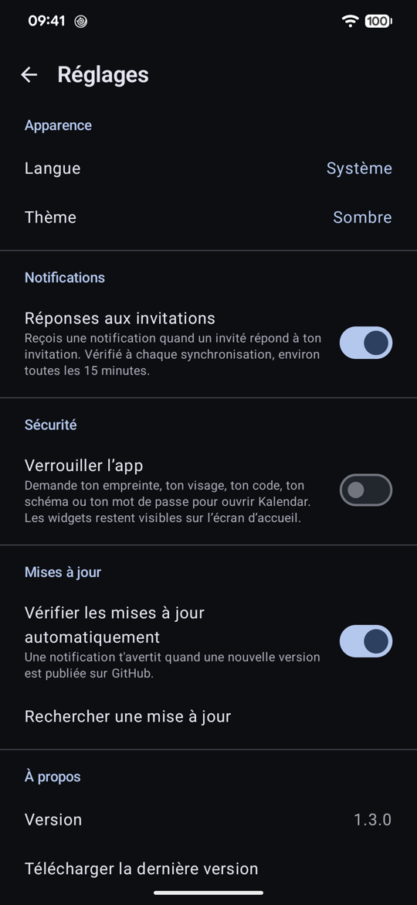<br><sub>Réglages, thème sombre</sub></td>
  </tr>
</table>

### Gestes sur un événement

Dans la liste d'un jour, comme dans la vue agenda : glisse un événement **vers la droite pour le modifier**, **vers la gauche pour le supprimer**. Le geste ne fait que demander : l'écran de modification s'ouvre, ou la confirmation de suppression (avec le choix « cette occurrence / les suivantes / toute la série » pour une série). Les calendriers en lecture seule n'ont pas ces gestes.

<table>
  <tr>
    <td align="center">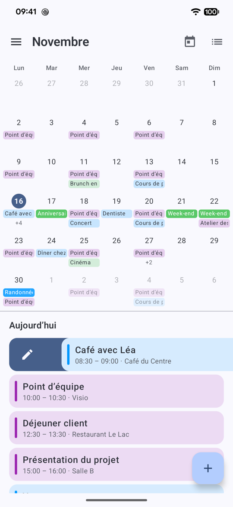<br><sub>Vers la droite : modifier</sub></td>
    <td align="center">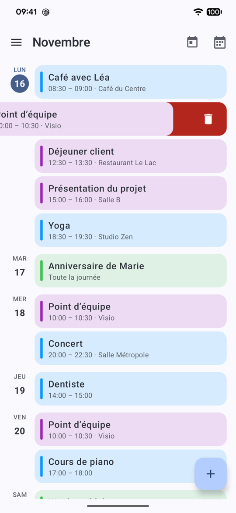<br><sub>Vers la gauche : supprimer</sub></td>
  </tr>
</table>

### Widgets

<table>
  <tr>
    <td align="center">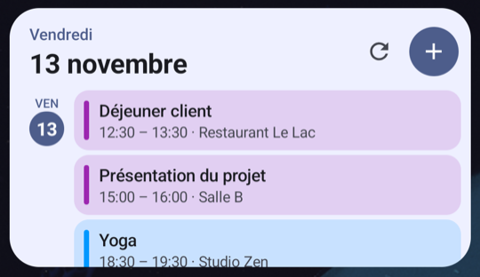<br><sub>Agenda, clair</sub></td>
    <td align="center">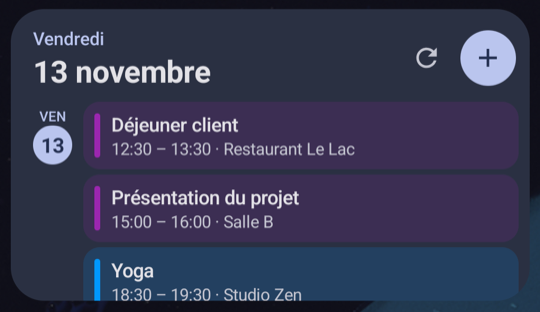<br><sub>Agenda, sombre</sub></td>
  </tr>
  <tr>
    <td align="center">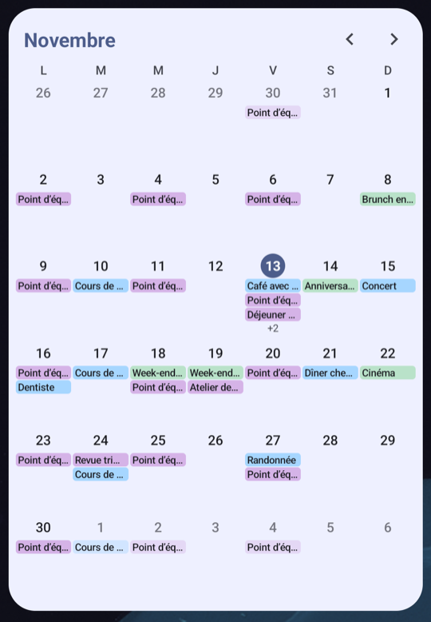<br><sub>Mois, clair</sub></td>
    <td align="center">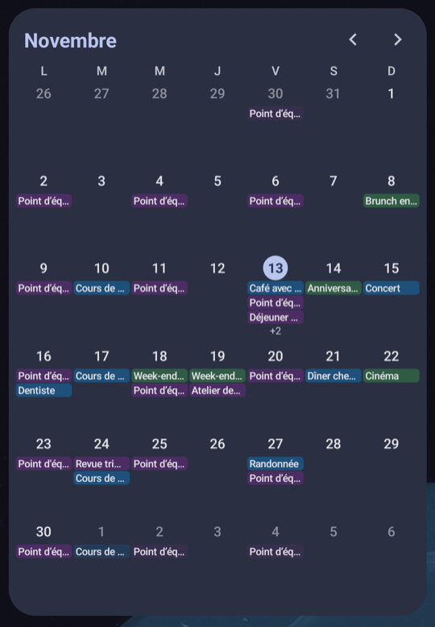<br><sub>Mois, sombre</sub></td>
  </tr>
</table>

Les widgets suivent le thème du système. Les données des captures sont fictives (voir « Captures d'écran » plus bas).

## Fonctionnalités

- **Vues** : mois et agenda, plusieurs calendriers avec leurs couleurs, affichage ou masquage par calendrier.
- **Gestes** : glisser un événement vers la droite pour le modifier, vers la gauche pour le supprimer.
- **Événements** : créer, modifier, supprimer ; journée entière, fuseaux horaires, lieu, notes, rappels.
- **Séries récurrentes** : modifier ou supprimer *cette occurrence*, *celle-ci et les suivantes*, ou *toute la série*.
- **Invitations** : voir l'organisateur et les réponses des invités, répondre (oui / peut-être / non), inviter des personnes par e-mail (les adresses déjà utilisées sont proposées la fois suivante). Le serveur envoie les courriels d'invitation et de réponse.
- **Rappels** : notifications à l'heure voulue, même appareil en veille. Par défaut, un rappel 1 heure avant ; un nouvel événement dure 1 heure et commence à 06:00 (ou à l'heure pleine suivante, aujourd'hui).
- **Réponses aux invitations** : une notification quand un invité répond (oui, peut-être, non) à une invitation que tu as envoyée. Il n'y a pas de « push » avec CalDAV : la réponse est repérée à la synchronisation suivante, au plus tard environ 15 minutes après.
- **Langues** : français, anglais, allemand, espagnol. La langue du système par défaut, ou un choix dans les réglages.
- **Thème** : clair, sombre, ou celui du système.
- **Verrouillage** : l'app peut demander ton empreinte, ton visage, ton code, ton schéma ou ton mot de passe d'écran. Les widgets restent visibles sur l'écran d'accueil.
- **Widgets** : *Agenda* (les prochains événements, jour par jour) et *Mois* (grille du mois avec le nom des événements dans chaque case, navigation d'un mois à l'autre ; un appui sur le nom du mois ramène au mois courant).
- **Mises à jour** : l'app vérifie sur GitHub si une nouvelle version existe, te le signale par une notification (désactivable) et la télécharge pour l'installer, depuis *Réglages → Mises à jour*. Android demande toujours une confirmation avant d'installer : une mise à jour totalement silencieuse n'est pas possible.
- **Hors ligne** : les événements déjà synchronisés restent visibles ; sans réseau, l'app l'indique et ne modifie rien.
- **Synchronisation** : toutes les 15 minutes, à l'ouverture, et à la demande. Les modifications sont refusées si l'événement a changé entre-temps sur le serveur (aucun écrasement silencieux).
- **Confidentialité** : le mot de passe est chiffré avec le Keystore Android ; l'app ne parle qu'à ton serveur CalDAV.

## Installer Kalendar

Pas besoin de compiler quoi que ce soit : l'application est publiée toute prête.

### 1. Télécharger l'application

1. Sur ton téléphone Android, ouvre la page des [**releases**](https://github.com/nthnbch/kalendar/releases/latest).
2. Télécharge le fichier **`Kalendar-x.y.z.apk`** de la dernière version.
3. Ouvre-le. Android te demande d'autoriser l'installation d'applications depuis ce navigateur (ou ce gestionnaire de fichiers) : accepte, puis appuie sur *Installer*. Android 8.0 minimum.

Les versions suivantes s'installent par-dessus, sans perdre tes réglages. Une fois l'app installée, elle te prévient elle-même quand une nouvelle version sort et peut la télécharger (*Réglages → Mises à jour*).

### 2. Un mot de passe d'application Infomaniak

L'app se connecte avec un identifiant de synchronisation et un mot de passe d'application (pas ton mot de passe de compte) :

1. Va sur <https://config.infomaniak.com> et ouvre l'assistant de synchronisation.
2. Choisis la synchronisation de l'agenda et génère un mot de passe d'application.
3. Note l'**identifiant** (de la forme `AB12345`) et le **mot de passe** affichés.

### 3. Se connecter

Dans l'app : serveur `https://sync.infomaniak.com`, identifiant et mot de passe d'application de l'étape 2. Les calendriers apparaissent après la première synchronisation.

### 4. Ajouter les widgets

Appui long sur l'écran d'accueil → *Widgets* → *Kalendar* → *Agenda* ou *Mois*.

### 5. Réglages

Menu ☰ → *Réglages* : langue, thème, notification des réponses aux invitations, verrouillage de l'app, mises à jour, version et lien vers le code source ([github.com/nthnbch/kalendar](https://github.com/nthnbch/kalendar)).

## Pour les développeurs : compiler soi-même

Prérequis : **JDK 17** et le **SDK Android** (variable `ANDROID_HOME`, ou `sdk.dir` dans `local.properties`).

```bash
git clone https://github.com/nthnbch/kalendar.git
cd kalendar
./gradlew assembleDebug
adb install -r app/build/outputs/apk/debug/app-debug.apk
```

Ou ouvre le dossier dans Android Studio et lance l'application sur un téléphone.

### Version signée

Pour une version « release » signée, crée un fichier `keystore.properties` à la racine (il est ignoré par git) :

```properties
storeFile=kalendar-release.jks
storePassword=...
keyAlias=...
keyPassword=...
```

puis `./gradlew assembleRelease`. **Sauvegarde ta clé** : sans elle, impossible de publier une mise à jour installable par-dessus.

## Connexion avec le bouton Infomaniak (désactivée)

Le code contient une connexion OAuth, masquée par défaut : Infomaniak ne donne les droits nécessaires (`user_info`, `user_password`) qu'à ses propres applications. Si cela change, ajoute dans `local.properties` : `infomaniakClientId=...`, `infomaniakClientSecret=...` et `infomaniakOAuth=true`.

## Tests

```bash
./gradlew testDebugUnitTest
```

Les tests couvrent l'analyse et l'écriture iCalendar, les récurrences, le CRUD complet d'un événement (création, lecture, modification, suppression), l'édition d'une occurrence ou d'une série (*cette occurrence*, *les suivantes*), les invitations et réponses (dont la détection d'une réponse d'invité), et le client CalDAV face à un serveur simulé (ETag, conflits, authentification).
La couche Android (écrans, widgets, notifications, vérification du réseau) n'est pas couverte par des tests automatiques ; elle a été vérifiée à la main sur émulateur et sur un appareil.

## Captures d'écran (build de démo)

Les captures viennent d'un build `demo` : un autre identifiant d'application (`ch.nthnbch.kalendar.demo`), installable à côté de la vraie app, avec un compte et un agenda inventés.

```bash
./gradlew assembleDemo
adb install -r app/build/outputs/apk/demo/app-demo.apk
adb shell am broadcast -n ch.nthnbch.kalendar.demo/ch.nthnbch.kalendar.demo.SeedReceiver
adb shell am force-stop ch.nthnbch.kalendar.demo   # puis ouvrir l'app
```

## Structure

```
app/src/main/java/ch/nthnbch/kalendar/
  dav/      client CalDAV (OkHttp)
  ical/     analyse / écriture iCalendar, récurrences
  data/     base locale, synchronisation, alarmes, compte chiffré
  ui/       écrans (Jetpack Compose) : agenda, éditeur, réglages, verrouillage
  widget/   widgets Glance (agenda, mois)
```
